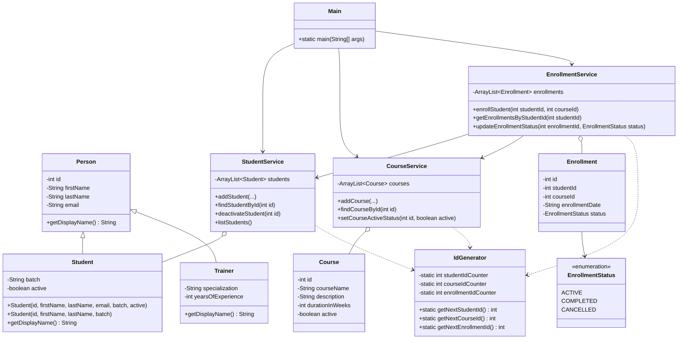

# LearnTrack — Student & Course Management System

LearnTrack is a console-based Student, Course, and Enrollment management application built in **Core Java**. It demonstrates clean package organization, OOP fundamentals (encapsulation, inheritance, polymorphism, constructor & method overloading), `ArrayList` collections, `static` utilities, and custom exception handling.

## Package Structure

```text
src/
└── com/airtribe/learntrack/
    ├── entity/
    │   ├── Person.java
    │   ├── Student.java
    │   ├── Trainer.java
    │   ├── Course.java
    │   ├── EnrollmentStatus.java
    │   └── Enrollment.java
    ├── exception/
    │   ├── EntityNotFoundException.java
    │   └── InvalidInputException.java
    ├── service/
    │   ├── StudentService.java
    │   ├── CourseService.java
    │   └── EnrollmentService.java
    ├── util/
    │   ├── IdGenerator.java
    │   └── InputValidator.java
    └── ui/
        └── Main.java
docs/
├── Setup_Instructions.md
├── JVM_Basics.md
└── Design_Notes.md
```

## Class Diagram



## How to Compile & Run

From the project root directory (`java-project/`):

```bash
# 1. Create output directory
mkdir -p out

# 2. Compile all Java sources
javac -d out $(find src -name "*.java")

# 3. Run the console application
java -cp out com.airtribe.learntrack.ui.Main
```

On Windows PowerShell:

```powershell
mkdir -Force out
javac -d out (Get-ChildItem -Recurse -Filter *.java src | ForEach-Object { $_.FullName })
java -cp out com.airtribe.learntrack.ui.Main
```
